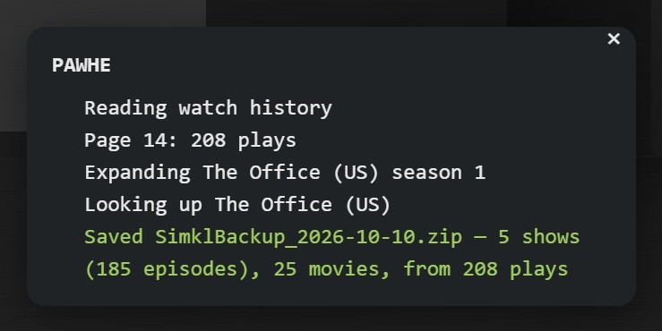

# PAWHE

**Plex Account Watch History Exporter** — a single browser-console script that exports the watch history of your **Plex account** and turns it into a backup file you can import into another tracking service.

> **This exports from your Plex *account*, not from a Plex Media Server.** Plex's account-level watch history (the one on [watch.plex.tv](https://watch.plex.tv/account/history)) has no export option, and very few tools target it. If you run your own server and want its history, see [Limitations](#limitations).



> **Currently supported target: [Simkl](https://simkl.com) only**, through its JSON backup import at <https://simkl.com/apps/import/json/>.
> The collection side is provider-agnostic, so other services (Trakt, Letterboxd, etc.) could be added if there is demand — [open an issue](../../issues) to ask for one.

## Why

Plex records everything you watch under **Account → Watch History** on [watch.plex.tv](https://watch.plex.tv/account/history), but offers no way to export it. That matters when your account holds the only copy: in my case, I no longer had access to the original server, so the history saved to my Plex account was all I had left.

Tools for exporting from a Plex Media Server are plentiful, but I found almost none built for the *account* history, and the few I tried didn't work. So I made PAWHE. It reads that history the same way the page does, in your own signed-in browser, and packages it for import elsewhere.

## Features

- Exports every episode and movie in your account's watch history, with its exact watch date and time (UTC).
- Follows pagination through the full history, not just the first page.
- Expands "Season N" bulk marks (a whole season marked as watched at once) into the individual episodes of that season.
- Keeps the **first** play of each episode or movie, since Simkl stores one watch date per item.
- Looks up show release years and episode totals from Plex, so shows are matched more reliably and fully watched shows are marked as completed.
- Paces its requests to Plex and retries automatically, slowing down if Plex rate-limits it.
- Produces a ready-to-upload `SimklBackup_<date>.zip`.
- No install, no dependencies, no account tokens to copy around. Nothing is sent anywhere except requests to `watch.plex.tv` itself.

## Usage

Tested in Chrome. Other browsers may work, but haven't been tested.

1. Sign in to Plex and open <https://watch.plex.tv/account/history>.
2. Open your browser's developer console (`F12` or `Ctrl+Shift+J` / `Cmd+Option+J`).
3. Paste the entire contents of [`PAWHE.js`](PAWHE.js) and press **Enter**.
   - Chrome and Edge may block pasting into the console the first time; type `allow pasting` and press Enter, then paste again.
4. A status panel (pictured at the top) appears in the bottom-right corner while it runs. When it finishes, `SimklBackup_<date>.zip` is downloaded.
5. Go to <https://simkl.com/apps/import/json/> and upload the zip **as is** (Simkl expects the zip, not the JSON inside it).

Yellow warnings don't stop the export. They flag shows where Plex didn't provide a release year (Simkl may match the wrong show; see [Settings](#settings-optional)) or where the episode total couldn't be read (the show is exported as "watching" instead of "completed"). If a warning says Plex pages couldn't be loaded, Plex didn't respond properly even after several retries; running the script again usually fixes it. A red "Failed" line means nothing was exported, and the message says why (for example, the script was run on the wrong page).

As with any script you paste into a browser console, read it first. It is a single readable file.

## Inspecting the results

After a run, you can inspect the results in the same console, as long as you don't reload the page. Type one of these and press Enter:

- `PAWHE.backup` — the exported data, exactly as written to the zip.
- `PAWHE.plays` — every play read from your history, repeats included.
- `PAWHE.skipped` — plays that were left out of the export (also logged as a warning when there are any).

In Chrome and Edge, `copy(PAWHE.backup)` copies it to the clipboard as JSON.

## Settings (optional)

You don't need to change anything: the script works as-is with the defaults. The `SETTINGS` block at the top of `PAWHE.js` is there for fine-tuning, typically after a first import, if Simkl matched a title to the wrong entry. Edit it before pasting the script.

| Setting | Default | Purpose |
| --- | --- | --- |
| `TITLE_OVERRIDES` | `{}` | Rename a Plex title to the title Simkl knows it by, e.g. `{ "Some Show (US)": "Some Show" }`. |
| `ID_OVERRIDES` | `{}` | Pin a title to a specific catalogue entry when title + year matches the wrong one. See below. |
| `SAVE_ALL_PLAYS` | `false` | Also download `pawhe_all_plays_<date>.json`, with every individual play, repeats included. |
| `PAGE_LIMIT` | `500` | Safety cap on the number of history pages fetched. |

Each `ID_OVERRIDES` key is `"movie|<title>|<year>"` or `"show|<title>|<year>"`, and the value holds the IDs to match on:

```js
ID_OVERRIDES: {
  "movie|Some Movie|2014": { imdb: "tt0000000", tmdb: "000000" }
}
```

`<title>` must be the title as it is written to the backup. That is the title exactly as Plex shows it, unless you renamed it in `TITLE_OVERRIDES`, in which case use the new name. For example, with `{ "Some Show (US)": "Some Show" }` in `TITLE_OVERRIDES`, the `ID_OVERRIDES` key is `"show|Some Show|<year>"`, not `"show|Some Show (US)|<year>"`.

## Limitations

- **Not a Plex Media Server export.** PAWHE only reads the history Plex stores on your account at watch.plex.tv. It does not talk to your own Plex Media Server, so it cannot export server-side history. For that, use one of the many tools made for exporting from a media server.
- **Matching is by title and year.** Plex does not expose IMDb/TMDb/TVDB IDs on watch.plex.tv, so Simkl has to match each title by name and release year. Check the import result and use `TITLE_OVERRIDES` / `ID_OVERRIDES` for anything that lands on the wrong entry, then export and import again.
- **Episode numbering can differ between services.** For example, a two-part episode that Plex lists as one episode may be two episodes on Simkl (or the other way round). Such episodes may need to be marked by hand after import.
- **Only the first play is kept.** Rewatches are not exported to Simkl. Use `SAVE_ALL_PLAYS` if you want a record of every play.
- **Only what Plex still has.** The export reflects your account's watch history as Plex currently shows it; plays Plex no longer lists cannot be recovered.
- **Unofficial.** PAWHE relies on how watch.plex.tv currently loads its pages and data. If Plex changes its site, the script may stop working until it is updated. If it stops working, [open an issue](../../issues).

## Contributing

Bug reports, fixes and requests for additional export targets are welcome via issues and pull requests.

## License

[MIT](LICENSE)

PAWHE is not affiliated with or endorsed by Plex or Simkl.
